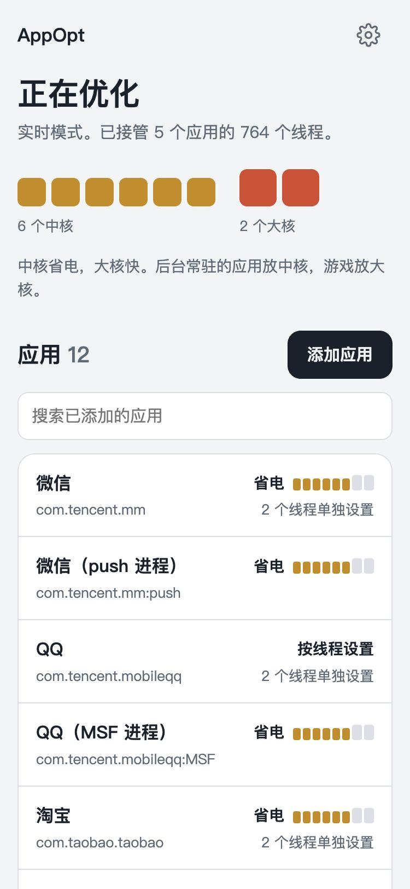

# AppOpt

Android 线程 CPU 亲和性优化模块。以 root 常驻后台，按规则把指定应用的进程或线程放到合适的 CPU 核心上：后台常驻的应用放在省电的核心，游戏和常用应用的关键线程放在大核。规则用网页面板就能设置，也可以直接编辑规则文件，保存后立即生效。

<p>
  
  
  
</p>

网页面板截图，来自一加 13（骁龙 8 至尊版）上实际运行的 AppOpt。

基于 Suto 的 [AppOptR](https://gitee.com/sutoliu/AppOptR) 二次开发，以 GPL-3.0 发布，见 [LICENSE](LICENSE)。

## 安装

需要：

- 已 root，root 方案支持 Magisk 模块格式（Magisk 20.4 及以上、KernelSU 等）
- arm64 或 x86_64 设备

在 root 管理器的模块页选择安装包刷入，重启后生效。安装时会打印本机的核心分层，例如骁龙 8 至尊版：

```
0-5 为性能中核，频率最高3532 MHz
6-7 为高性能大核，频率最高4320 MHz
这颗芯片没有能效小核，规则里的 e-core 指 0-5
```

装好以后：

- 网页面板：手机浏览器打开 `http://127.0.0.1:8889`。
- 规则文件：`/data/adb/modules/AppOpt/applist.conf`，自带一份常用应用和游戏的默认规则。
- 设置文件：同目录的 `AppOpt.json`。
- 再次刷入新版本时，沿用已有的规则文件和设置。

## 网页面板

打开面板先看到运行状态和本机核心图：小核、中核、大核按大小和颜色区分。下面是已添加的应用，每个应用标出它用哪些核心。

添加或调整应用时：

1. 选应用。输入框会列出正在运行的应用，常见应用可以直接搜中文名，其他应用搜包名或直接输入包名。
2. 选运行方式：

   | 选项 | 用到的核心 |
   |------|------------|
   | 省电 | 小核；没有小核的芯片上是最省电的一组中核 |
   | 均衡 | 小核和中核 |
   | 流畅 | 中核和大核 |
   | 性能 | 大核 |
   | 不限制 | 全部核心 |
   | 自定义 | 手动填写核心编号，如 `0-3,7` |

   每个选项都标出会用到哪几个核心。本机没有对应分层的选项不显示，效果和"不限制"相同的选项也不显示。
3. 需要时展开"按线程单独设置"，给某个线程单独指定核心，比如游戏的渲染线程。线程名可以从正在运行的进程里挑，主线程会标注出来。

设置里可以切换工作方式（自动、实时模式、定时扫描），调整检查间隔。cpuset 目录名和规则文件路径放在高级设置里，一般不用改。

面板只监听本机回环地址，没有身份认证，本机上的任何应用都能读写规则与设置。不需要面板时，把 `AppOpt.json` 的 `web_enable` 改为 `false`，重启后生效。

## 规则文件

`applist.conf` 每行一条规则。`#` 或 `//` 开头的行是注释，行内注释前面要有空白。

```
# 包级规则：整个应用的进程
com.example=0-3

# 子进程带后缀
com.tencent.mm:push=e-core

# 单行线程规则
com.android.systemui{RenderThread}=hp-core

# 块语法：包级规则加若干线程规则，包级规则可省略
com.example=e-core,p-core {
	RenderThread=hp-core
	Worker-*=p-core
}
```

CPU 的写法：

- 核心编号，如 `0-3,6`。超出本机核心的部分会被去掉。
- 语义核心：`e-core` 小核、`p-core` 中核、`hp-core` 大核、`all-core` 全部核心。
- 两种写法可以用逗号混写，如 `e-core,p-core`、`e-core,7`。

语义核心按 cpufreq 策略分档，最高频率（`cpuinfo_max_freq`）相同的策略算一档：

- 最高的一档是 `hp-core`。
- 其余各档里，相对性能（内核给出的 `cpu_capacity`，最强核心为 1024）不到最高一档一半的是小核，其余合并为 `p-core`。
- `e-core` 指小核。没有小核的芯片上（如骁龙 8 至尊版的 6 个性能核加 2 个超大核），`e-core` 指最低一档，这一档同时也属于 `p-core`。
- 内核不提供 `cpu_capacity`，或它的值不低于最高一档时，改按频率分层：最低一档是 `e-core`，中间各档是 `p-core`。
- 只有一档时全部算 `e-core`，`p-core` 和 `hp-core` 为空。

匹配规则：

- 线程名支持通配符 `*`、`?`、`[...]`、`[!...]`。多条线程规则同时命中时取并集。
- 线程没有命中线程规则时，按包级规则；同一个包的多条包级规则取并集。
- 只有线程规则、没有包级规则的包，没命中的线程可以用全部核心。
- 内核里的线程名最长 15 字节，长包名的主线程名是包名的末 15 字节。例如 `com.tencent.mobileqq` 的主线程叫 `encent.mobileqq`，规则要按这个名字写。
- 包名不超过 127 字节，线程名不超过 31 字节。

写法有误或取值无效的行会被跳过，每次载入时逐行打印警告，面板也会提示跳过的行数。

## 工作方式

程序用两种方式发现目标线程：

- 实时模式（eBPF）：内核里挂在 `sched_process_fork`、`sched_process_exec`、`sched_process_exit`、`task_rename` 四个 tracepoint 上，只把命中包名白名单的事件交给用户态处理。进程和线程一出现就绑定，包括应用启动瞬间批量创建的线程。需要内核提供 BTF（`/sys/kernel/btf/vmlinux`）。
- 定时扫描（/proc）：每个检查间隔扫描一次 `/proc`，另有周期性的全量扫描兜底，所有设备都能用。

工作方式有三种：

- 自动：优先用实时模式，初始化失败一次后改用定时扫描。
- 强制实时模式：不可用时每 30 秒重试一次，期间用定时扫描。
- 定时扫描。

绑定线程时，先把它移进 `/dev/cpuset/<目录名>/<核心范围>/tasks`（cpuset cgroup v1，目录按需创建），再调用 `sched_setaffinity`。系统没有 `/dev/cpuset` 时只做后一步。线程已经在目标核心上时不做任何写入。

规则文件所在目录由 inotify 监听，保存即重新载入。程序任何线程出现 panic 都会直接退出，不会在半工作的状态下继续运行。

## 命令行与设置文件

```
AppOpt [-c <规则文件>] [-s <秒>] [-b <目录名>] [-w]
```

| 参数 | 说明 | 默认值 |
|------|------|--------|
| `-c <file>` | 规则文件路径，不存在时创建 | `./applist.conf` |
| `-s <seconds>` | 检查间隔，1-3600 秒 | `2` |
| `-b <name>` | cpuset 目录名，即 `/dev/cpuset/<name>`，不能含 `/` 和空白 | `AppOpt` |
| `-w` | 启用网页面板 | 关闭 |
| `-v` | 显示版本 | |
| `-h` | 显示帮助 | |

设置保存在工作目录下的 `AppOpt.json`。首次运行时自动创建，命令行参数优先于文件，面板里的修改会写回文件：

| 字段 | 含义 |
|------|------|
| `web_enable` | 是否启用网页面板 |
| `mode` | `0` 自动，`1` 强制实时模式，`2` 定时扫描 |
| `check_interval` | 检查间隔（秒） |
| `cpuset_name` | cpuset 目录名 |
| `config_file` | 规则文件路径 |

缺少的字段取默认值。字段存在但取值无效，或文件不是合法 JSON 时，程序报错退出，不会覆盖原文件。

## 网页面板接口

面板通过下面的接口工作，只接受来自本机页面的请求：`Host` 必须是回环地址，POST 必须是 JSON。

| 方法 | 路径 | 作用 |
|------|------|------|
| GET | `/api/status` | 运行状态、命中统计、核心分层 |
| GET | `/api/rules` | 解析后的规则，按包名分组 |
| GET | `/api/config` | 当前设置与正在使用的工作方式 |
| POST | `/api/config` | 修改设置 |
| POST | `/api/rule` | 新增或更新规则 |
| POST | `/api/rule/del` | 删除规则 |
| POST | `/api/rule/rename` | 重命名包名 |
| POST | `/api/suggest` | 补全建议：不带 `pkg` 时给出包名，带 `pkg` 时给出该应用的线程名 |

字段类型不对或取值无效时返回 400 和中文原因。

## 构建与打包

主程序需要 Rust 1.98 及以上，编译成静态链接的 musl 程序，在 Android 上直接运行，不依赖系统库。在 arm64 的 Linux 或 Docker 里编译：

```bash
docker run --rm -v "$PWD":/repo -w /repo/AppOpt rust:slim sh -c 'rustup target add aarch64-unknown-linux-musl && cargo build --release --locked --target aarch64-unknown-linux-musl'
```

产物在 `AppOpt/target/aarch64-unknown-linux-musl/release/AppOpt`。x86_64 设备用 `x86_64-unknown-linux-musl` 目标。

eBPF 程序需要 `bpf-linker`，它链接的 LLVM 主版本要和编译用的 rustc 一致。例如 rustc 1.96 对应 LLVM 22，先装好 LLVM 22 的开发包（Debian 系为 `llvm-22-dev`），再：

```bash
cargo install bpf-linker --no-default-features --features llvm-22
rustup toolchain install 1.96.1 -c rust-src
cd AppOpt-ebpf
RUSTC_BOOTSTRAP=1 cargo +1.96.1 build --release --ignore-rust-version -Z build-std=core --target bpfel-unknown-none
```

产物在 `AppOpt-ebpf/target/bpfel-unknown-none/release/AppOpt-ebpf`，运行时与主程序放在同一目录，程序从那里加载。

模块安装包由 `module/` 的全部内容加上 `bin/<架构>/` 下的两个产物组成，安装脚本按设备架构取用：

```
bin/arm64-v8a/AppOpt
bin/arm64-v8a/AppOpt-ebpf
bin/x86_64/AppOpt
bin/x86_64/AppOpt-ebpf
```

只打 arm64 的包：

```bash
stage=$(mktemp -d)
cp -R module/. "$stage"
mkdir -p "$stage/bin/arm64-v8a"
cp AppOpt/target/aarch64-unknown-linux-musl/release/AppOpt "$stage/bin/arm64-v8a/"
cp AppOpt-ebpf/target/bpfel-unknown-none/release/AppOpt-ebpf "$stage/bin/arm64-v8a/"
(cd "$stage" && zip -qr "$OLDPWD/AppOpt-arm64.zip" .)
```

手机连着电脑时，可以用 adb 推送后直接安装，重启生效：

```bash
adb push AppOpt-arm64.zip /data/local/tmp/
```

```bash
adb shell 'su -c "/data/adb/ksud module install /data/local/tmp/AppOpt-arm64.zip"'
```

Magisk 用 `magisk --install-module <zip>`。

测试：Linux 上 `cargo test` 跑全部测试；其他平台用 `cargo test --lib`，只跑不依赖 Linux 的部分。

`module/` 下的文件：

| 文件 | 作用 |
|------|------|
| `module.prop` | 模块信息 |
| `customize.sh` | 安装脚本：检查环境，按架构放置程序，沿用已有的规则和设置，打印本机核心分层与规则示例 |
| `service.sh` | 开机后启动 `AppOpt`，并把各 cluster 的 `core_ctl` 最小核心数调到和最大值一致 |
| `applist.conf` | 默认规则 |
| `AppOpt.json` | 默认设置，开启网页面板 |
| `webroot/index.html` | 跳转到网页面板 |
| `META-INF/` | 刷入入口 |

## 源码结构

| 目录 | 内容 |
|------|------|
| `AppOpt` | 用户态主程序 |
| `AppOpt-ebpf` | eBPF 内核态程序 |
| `AppOpt-common` | 内核态与用户态共用的数据布局 |
| `web` | 网页面板页面，编译进主程序 |
| `module` | 模块源文件 |

`AppOpt/src` 下：

| 模块 | 功能 |
|------|------|
| `main.rs` | 程序入口，装配各部分 |
| `lib.rs` | 模块声明，非 Linux 平台只编译纯逻辑部分 |
| `cli.rs` | 命令行参数 |
| `settings.rs` | 设置文件 AppOpt.json 的读写与校验 |
| `shared.rs` | 跨线程共享状态：设置、当前规则集、规则文件的重载与编辑 |
| `grammar.rs` | applist.conf 语法：逐行分类与块结构扫描 |
| `config.rs` | 规则集：按包名索引，线程规则匹配 |
| `rule_edit.rs` | 规则文件的新增、更新、删除、重命名，保留注释 |
| `glob.rs` | 线程名通配匹配 |
| `cpuset.rs` | CPU 集合、核心分层、cpuset 目录与线程绑定 |
| `procfs.rs` | /proc 读取与目标进程扫描 |
| `cache.rs` | 受管线程缓存 |
| `daemon.rs` | 主循环，两种工作方式的选择与切换 |
| `ebpf_mode.rs` | 实时模式：加载 eBPF 程序并处理内核事件 |
| `proc_mode.rs` | 定时扫描 |
| `watcher.rs` | 规则文件监听 |
| `fsutil.rs` | 原子写文件 |
| `web.rs` | 网页面板的 HTTP 服务与接口 |
